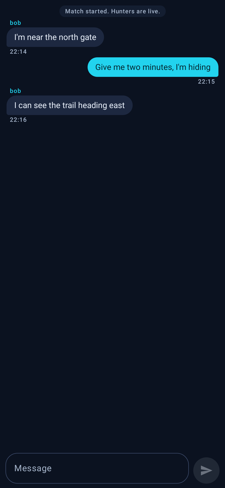

# ManHunt

ManHunt is a real-world game of hide-and-seek for Android. **Prey** hide while their phones
report periodic GPS positions; **Hunters** follow those positions on a map and tag prey by
physically touching them. A Node.js server is authoritative: it owns timers, teams, tags,
location visibility and chat, so clients can restart or lose signal safely.

## Screenshots

| Chat (dark) | Chat (Arabic, RTL) |
|---|---|
|  |  |

Rendered from the real Compose UI by `ScreenshotTest` (Robolectric), not mockups.

## Download

The installable APK is published on the [Releases](https://github.com/MostafaAshry513/ManHunt/releases)
page for every tagged version. Debug builds are unsigned for Play, but install fine on a phone.

## Repository layout

```
ManHunt/
|-- android/        Kotlin + Jetpack Compose app (OkHttp REST/WS, osmdroid, location service)
|-- server/         Fastify REST + WebSocket API, SQLite; src/, test/, scripts/
|-- docs/           Architecture, API reference, testing, security, deployment, runbook
|-- scripts/deploy/ Windows scheduled-task, backup and healthcheck helpers
`-- .github/        CI workflow (committed; not verified on this host)
```

## Prerequisites

| Tool | Version used | Path on this machine |
|---|---|---|
| JDK | Temurin 21 | `C:\Android\jdk-21` |
| Android SDK | Platform 37, Build-Tools 36 | `C:\Android\Sdk` |
| Node.js | 24 (native TypeScript, no build step) | on `PATH` |

The Android scripts set `JAVA_HOME`; `android/local.properties` points at the SDK. Android Studio is not required.

## Backend

```powershell
cd C:\dev\ManHunt\server
npm ci
npm test
npm start
```

The server listens on `http://127.0.0.1:8080` and stores SQLite data in `server\data\manhunt.db`.
For phones, bind all interfaces: `$env:HOST = '0.0.0.0'; npm start`.

| Variable | Default | Meaning |
|---|---|---|
| `PORT` | `8080` | HTTP/WebSocket port |
| `HOST` | `127.0.0.1` | Bind address; use `0.0.0.0` for a phone on the LAN |
| `DB_PATH` | `server\data\manhunt.db` | SQLite file |
| `SESSION_DAYS` | `30` | Login token lifetime |
| `LOCATION_RETENTION_DAYS` | `30` | Precise GPS history retention |

### Verified checks

Run backend commands from `server\` and Android commands from `android\`; the two `node scripts/*.mjs` checks need a server already running.

| Command | Verified result | What it proves |
|---|---|---|
| `npm test` | 45/45 pass | Domain rules, auth, rooms, match lifecycle, tags, history, security (`node --test` + `fastify.inject`) |
| `npx tsc --noEmit` | clean | TypeScript type gate (Node runs the `.ts` files directly) |
| `node scripts/smoke.mjs` | 11 checks | Live HTTP + WebSocket: health, registration, room, start, hunter-only location push, chat |
| `node scripts/match-sim.mjs` | 13 checks | Three simulated players: pause/resume, live location, tag + confirm, spectator lockout, history, reconnect |
| `.\test.ps1` (Android) | 21/21 pass | JVM + Robolectric tests; no emulator or device needed |

Both scripts default to `http://127.0.0.1:8080`; pass another base URL, e.g. `node scripts/smoke.mjs http://127.0.0.1:8123`.

## Android

```powershell
cd C:\dev\ManHunt\android
.\build.ps1      # debug APK
.\test.ps1       # JVM tests (fast, no device)
.\install.ps1    # install + launch on a connected phone
```

APK: `android\app\build\outputs\apk\debug\app-debug.apk`; test report: `android\app\build\reports\tests\testDebugUnitTest\index.html`.
`install.ps1` needs a device: enable Developer options > Wireless debugging, run `adb pair <ip:port>` once, `adb connect <ip:port>`, then `.\install.ps1`. No usable emulator here (no nested virtualisation).

**Pointing the app at a server:** on the sign-in screen tap **Server: http://10.0.2.2:8080**, enter the URL
and tap **Save server**. Use `http://10.0.2.2:8080` only from an emulator; on a real phone use the PC's LAN
address, e.g. `http://192.168.1.20:8080`. Changing it signs you out.

## Playing a match with two phones

1. On the PC run the backend with `$env:HOST='0.0.0.0'`; if Windows Firewall prompts, allow Node on the private network.
2. Connect both phones to the same Wi-Fi, install the APK, and set the same server URL.
3. Register one account per phone (username 3-24 letters/numbers/underscore, password 8+).
4. Phone A: **Create room** and share the 6-character code. Phone B: enter the code and **Join room**.
5. Pick teams (at least one Prey and one Hunter) and both tap **I'm ready**.
6. Admin (phone A) opens **Match settings** (head start defaults to 5 minutes) and taps **Start match**.
7. The Prey taps **Enable GPS** and grants permission so the foreground service reports positions; the Hunter follows the map.
8. When physically touching a prey, the Hunter taps **Tag prey** and picks the player; the Prey confirms or disputes.
9. The match ends at the timer (Prey win if anyone survives) or when all prey are tagged (Hunters win). History is in the room.

## Status and limitations

Implemented and exercised: backend auth, rooms, teams, readiness, head start, hunting, pause/resume,
tagging with confirm/dispute/admin resolve, location tracking with validation and flags, zone +
shrink computation, chat, match history, and the Android client for the core game loop.

Honest gaps as of 2026-10-29:

- **No emulator and no phone attached on this host.** Real GPS fixes, foreground-service behaviour, map tile rendering and two-phone UX are implemented but unverified on hardware.
- **Public HTTPS is not verified.** There is no domain, TLS certificate or inbound firewall rule; the server remains local/LAN only. See `docs/DEPLOYMENT.md`.
- **Debug builds use cleartext HTTP** (`usesCleartextTraffic=true`). Tokens and locations are unencrypted; use only on a trusted LAN, never on the public internet.
- **Rematch bug:** a finished match does not clear eliminated players, so after all prey were
  tagged the next **Start match** is rejected (`cannot_start`). Start a new room (or have the
  tagged prey leave and rejoin) until this is fixed.
- The Android UI has no End-match or resolve-dispute button yet; those REST endpoints exist and
  are covered by backend tests. Zone shrink `warningSec` is stored but no warning is emitted, and zone
  boundaries are not enforced server-side. Match history rosters use current membership, not a per-match snapshot.
- CI (`.github/workflows/ci.yml`) is committed but not verified here: this host has no GitHub authentication.

## Documentation

All project docs live in [docs/](docs/). Highlights:

- [Architecture](docs/ARCHITECTURE.md) - components, state machine, data model, contracts
- [API reference](docs/API.md) - every REST endpoint, WebSocket event, settings and phases
- [Environment](docs/ENVIRONMENT.md) - exact toolchain and host-specific fixes
- [Testing](docs/TESTING.md) - what was executed and what remains unverified
- [Security](docs/SECURITY.md) | [Security review](docs/SECURITY_REVIEW.md)
- [Deployment](docs/DEPLOYMENT.md) | [Runbook](docs/RUNBOOK.md)
- [Decisions](docs/DECISIONS.md) | [Implementation plan](docs/IMPLEMENTATION_PLAN.md)
- [Research](docs/RESEARCH.md) | [Android build notes](android/README.md)

## License

MIT — see [LICENSE](LICENSE). Third-party skill files keep their own licenses (Apache-2.0, MIT, CC BY-SA 4.0) in `.opencode/skills/`.
