# ManHunt

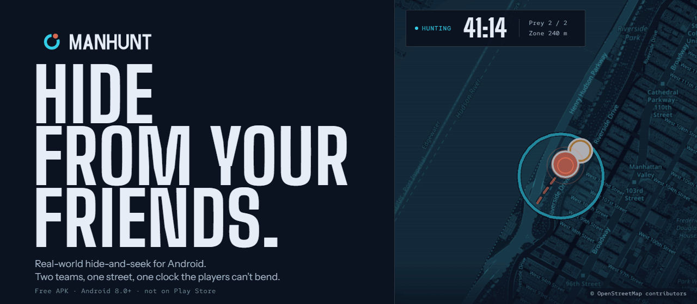

**Hide from your friends.** Real-world hide-and-seek, played on your street. Two teams, one street, one
clock the players can’t bend. Prey hide; Hunters track the latest reports on a live map and tag them in
person.

[Install the free APK](http://74.208.99.178/) | [Watch the 60-second film](#watch-the-film) | [Latest release](https://github.com/MostafaAshry513/ManHunt/releases/latest)

<sub>Free APK · Android 8.0+ · not on Play Store · [status and limits](#status-and-limits)</sub>

---

## The map is the field

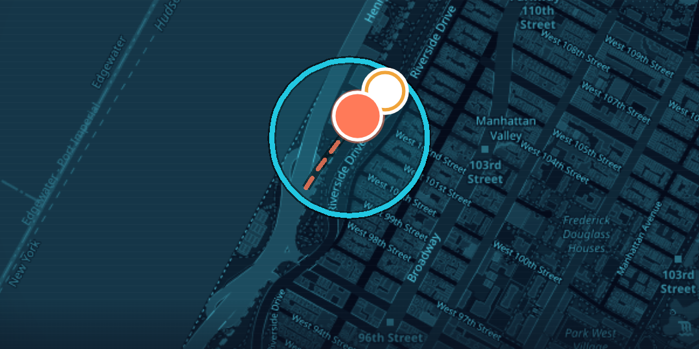

<sub>Live hunt in the app, “Riverside Run” · real OpenStreetMap tiles · Map data © OpenStreetMap contributors</sub>

Hunters see the **latest report** from each phone, not a perfect live feed. Prey see the field, the zone
and their own position — never other players’ positions. The zone and the trails are the host’s call; the
server keeps the clock.

- **Zone** — the area the host sets for the round.
- **Latest report** — where a phone last checked in, not where it is now.
- **Trail** — movement history, off unless the host turns it on.
- **The clock** — server-timed; it pauses for everyone or for nobody.

## Two sides

<table>
<tr>
<td width="50%"></td>
<td width="50%"></td>
</tr>
<tr>
<td><strong>Hide. Stay free.</strong> Your phone reports your position to the Hunters at the room’s
interval. Stay out until the clock stops — if one Prey is still free, Prey win.</td>
<td><strong>Track. Tag.</strong> Follow the latest reports and trails. Find a Prey in the real world and
tag them in person — they confirm or dispute, and the server decides what counts.</td>
</tr>
</table>

## Four beats, one organiser

| | | | |
|---|---|---|---|
| <sub>01 · ROOM</sub><br>**The host creates the hunt** and shares a six-character code with the group. | <sub>02 · SIDES</sub><br>**Everyone picks a side**, Prey or Hunters, then readies up in the same room. | <sub>03 · HUNT</sub><br>**The server runs the rules**: clock, zone, trails and report interval. | <sub>04 · RESULT</sub><br>**Full time.** Prey win if anyone is still out; otherwise Hunters win. |

## In the app

Real captures from the app, seeded with a believable “Riverside Run” game on a test server — same phone,
same room, one honest run from the host plate to the final score.

| | | | |
|---|---|---|---|
| <a href="docs/screenshots/premium/s03-home.png">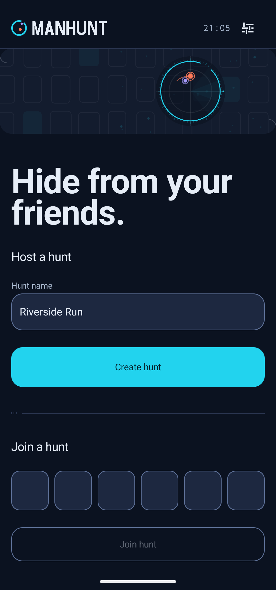</a> | <a href="docs/screenshots/premium/s05-lobby-host.png">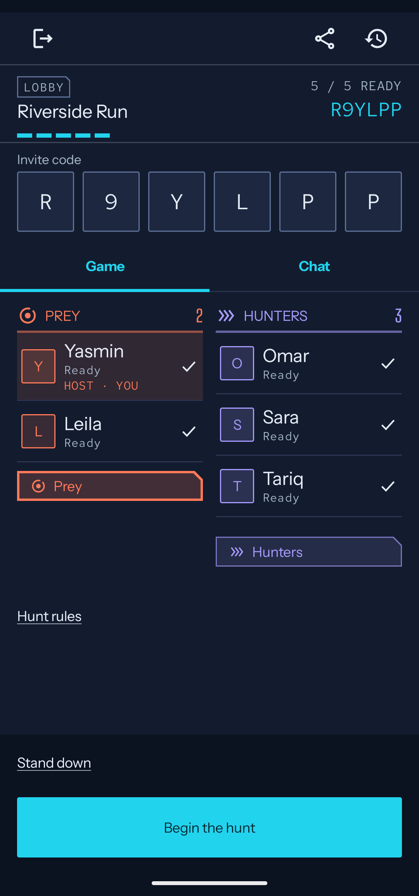</a> | <a href="docs/screenshots/premium/s07-hunt.png">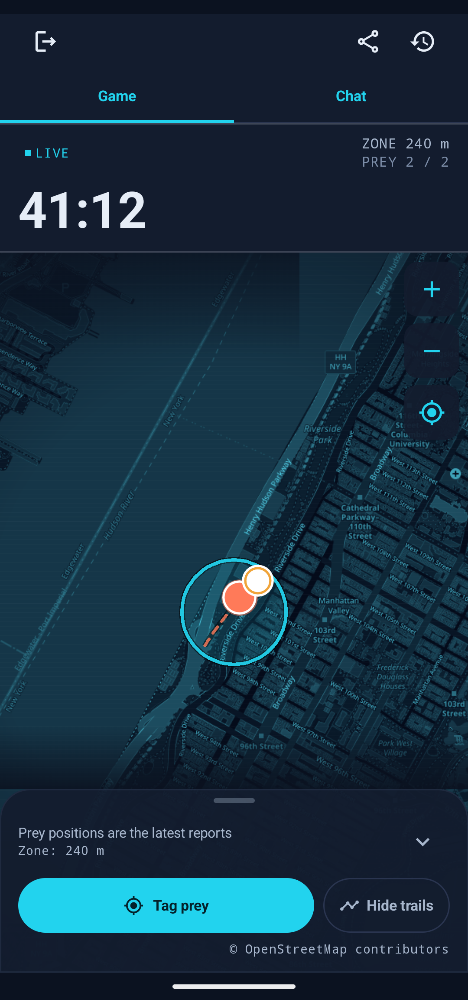</a> | <a href="docs/screenshots/premium/s12-result-hunters.png">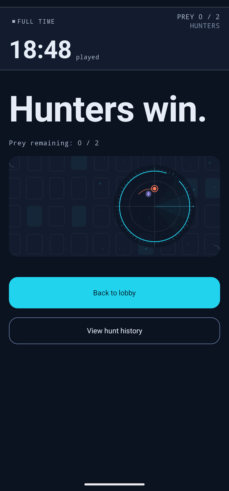</a> |
| <sub>Home — host or join</sub> | <sub>Lobby — code, teams, ready</sub> | <sub>Live hunt — reports, trails, zone</sub> | <sub>Result — Hunters win, full time</sub> |

<details>
<summary>More screens</summary>

| | | | |
|---|---|---|---|
| <a href="docs/screenshots/premium/s08-hunt-claim.png">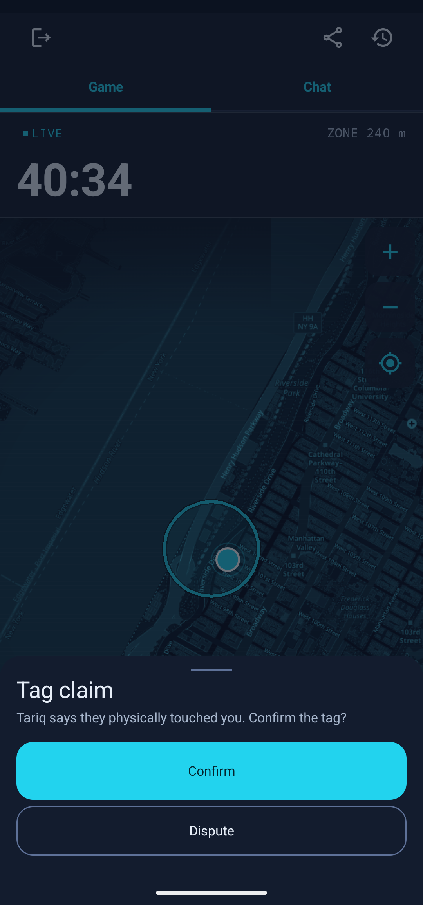</a> | <a href="docs/screenshots/premium/s09-tag-target-sheet.png">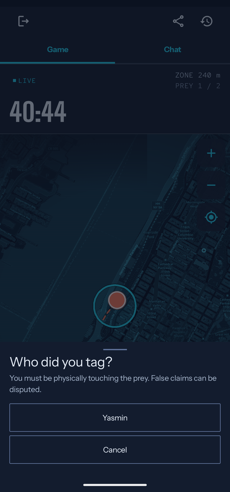</a> | <a href="docs/screenshots/premium/s11-chat.png">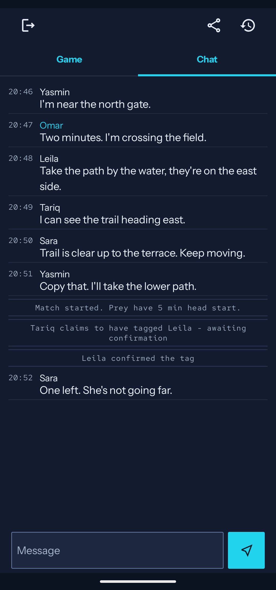</a> | <a href="docs/screenshots/premium/s15-home-light.png">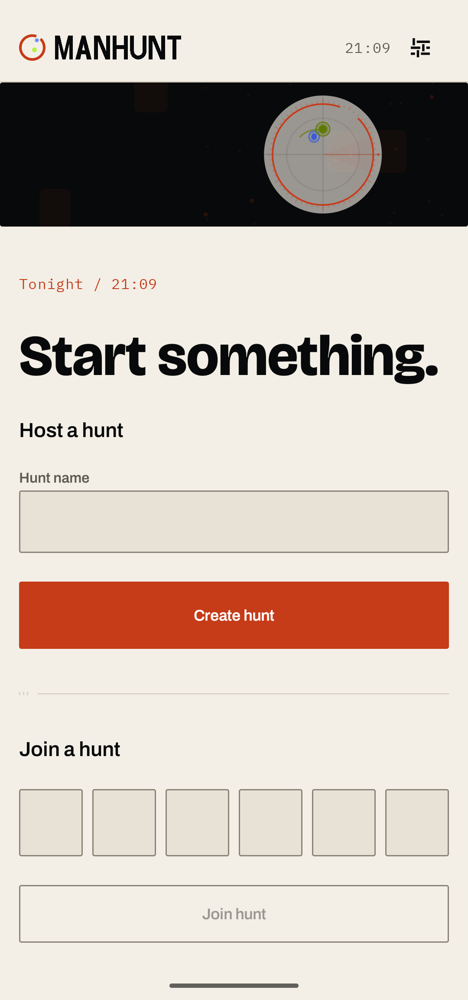</a> |
| <sub>Tag claim — confirm in person</sub> | <sub>Who did you tag? — pick the target</sub> | <sub>Chat — the room log</sub> | <sub>Light theme — same board</sub> |

</details>

## Watch the film

<table>
<tr>
<td width="200" valign="top"><a href="https://raw.githubusercontent.com/MostafaAshry513/ManHunt/master/design/social/motion/out/v5/manhunt_explainer_60s_1080x1920.mp4">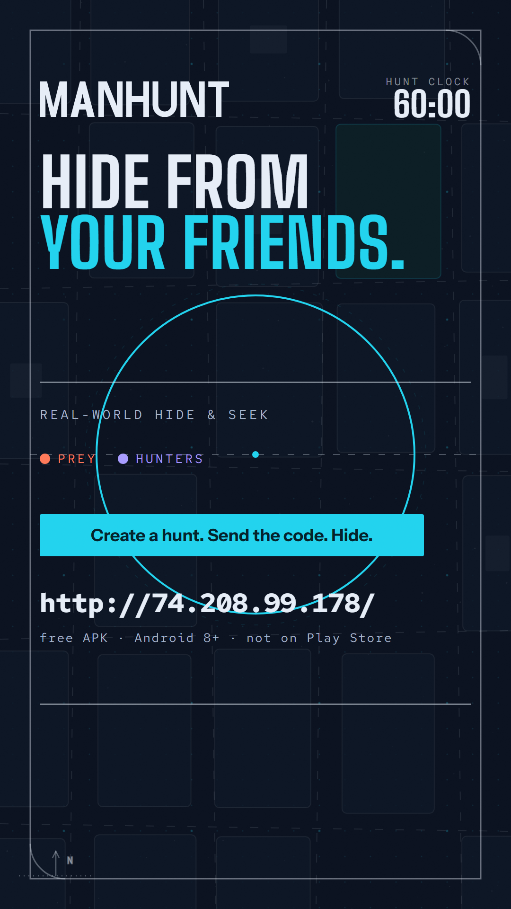</a></td>
<td><strong>One minute, the whole loop.</strong> The hook, the two sides, how phones report position, how
Hunters track reports, how tagging works, and the server clock. Fully animated — no real people or stock
footage.

[60-second explainer](https://raw.githubusercontent.com/MostafaAshry513/ManHunt/master/design/social/motion/out/v5/manhunt_explainer_60s_1080x1920.mp4) | [30-second cut](https://raw.githubusercontent.com/MostafaAshry513/ManHunt/master/design/social/motion/out/v5/manhunt_explainer_30s_1080x1920.mp4) | [15-second hook](https://raw.githubusercontent.com/MostafaAshry513/ManHunt/master/design/social/motion/out/v5/manhunt_15s_1080x1920.mp4) | [six-second GIF](https://raw.githubusercontent.com/MostafaAshry513/ManHunt/master/design/social/motion/out/v5/manhunt_teaser_720x1280.gif)</td>
</tr>
</table>

## The rules the server keeps

| Rule | What the server keeps |
|---|---|
| **The clock** | Server-timed start, head start, pause/resume and full time. A pause shifts the clock for everyone, so nobody loses time. |
| **The sides** | Prey and Hunters are set per room. Prey positions are visible only to the Hunters in that room, only during the hunt. |
| **Tags** | A tag claim is stored, then confirmed or disputed by the Prey. A Huntmaster resolves disputes; duplicate claims cannot double-apply. |
| **The zone** | Open play or a circular zone with a step-down shrink and countdown. Boundaries are informational — the app does not stop you crossing them. |
| **Reconnects** | A dropped phone can rejoin. Room state lives on the server, not the phone, so losing signal does not bend the rules. |
| **The map** | Real OpenStreetMap tiles. Prey positions are the latest reports, not a perfect live feed. Trails are the host’s call. |

<sub>Why this exists: in most real-world games the rules are social. Here they are kept by the server, so
an argument about the clock or a tag has an answer.</sub>

## Get on the field

> **Free, signed APK. No account email. Not on Google Play.** Android 8.0+ · about 2.4 MB · the current
> version, size and SHA-256 are always on the install page.

**[Download the free APK](http://74.208.99.178/)**

1. **Download the APK** on the Android phone you will play on.
2. **Allow installs from this source** when Android asks. If it does not ask: Settings → Apps → Special
   app access → Install unknown apps.
3. **Open ManHunt and create a local account** — no email required. Host a hunt or join one with a code.

Play Protect may warn about a sideloaded app; that is normal for a signed APK installed outside a store.
Install anyway only if you trust this repository. In-app updates verify the SHA-256 before installing.

## Status and limits

ManHunt is an active hobby project, not a polished consumer product. Honest list:

1. **The hosted deployment is plain HTTP** at a bare IP — session tokens and GPS data are not encrypted
   in transit. Use test data only, or self-host behind HTTPS.
2. **The hosted server is a test server.** One VM, SQLite, no availability guarantee; data may be wiped.
   No email is collected, so there is no password recovery.
3. **Play with people you trust.** GPS is shared with the Hunters in your room during a match. ManHunt is
   a game, not a safety or tracking service.
4. **Zones are informational.** Players can physically leave the zone; the shrink countdown is not
   enforced server-side.
5. **Verified in CI on an Android emulator**, not re-verified on physical phones. Real GPS battery
   behaviour depends on the device.
6. **Not on Google Play.** Sideloading means “unknown sources”, possible Play Protect warnings, and no
   store-managed updates.

[Security](docs/SECURITY.md) | [Architecture](docs/ARCHITECTURE.md) | [Deployment](docs/DEPLOYMENT.md) | [Runbook](docs/RUNBOOK.md) | [All documentation](docs/README.md)

<details>
<summary>Build it, or host it yourself</summary>

The backend is one Node.js process with the built-in SQLite driver — no database server, no Docker, no
external services. A small game can run on one machine.

```bash
git clone https://github.com/MostafaAshry513/ManHunt.git
cd ManHunt/server
npm ci
npm start          # http://127.0.0.1:8080
```

To let phones on your network connect, bind all interfaces with `HOST=0.0.0.0 npm start`, then set the
server address on the app’s sign-in screen. Changing the server signs you out.

Quality gates run in CI on every push: server typecheck and `node --test`, a live HTTP/WebSocket smoke
test, a scripted match simulation, the Android debug/release builds, JVM tests, lint and an in-app test on
a real Android emulator.

[Testing](docs/TESTING.md) | [API reference](docs/API.md) | [Decisions](docs/DECISIONS.md) |
[Contributing](CONTRIBUTING.md) | [Changelog](CHANGELOG.md)

</details>

<picture>
  <source media="(prefers-color-scheme: dark)" srcset="docs/brand/lockup-light-on-dark.png">
  
</picture>

<sub>MIT licensed · Map data © [OpenStreetMap contributors](https://www.openstreetmap.org/copyright) (ODbL) ·
free sideloaded APK, not on Google Play · ManHunt is a game, not a safety service.</sub>
