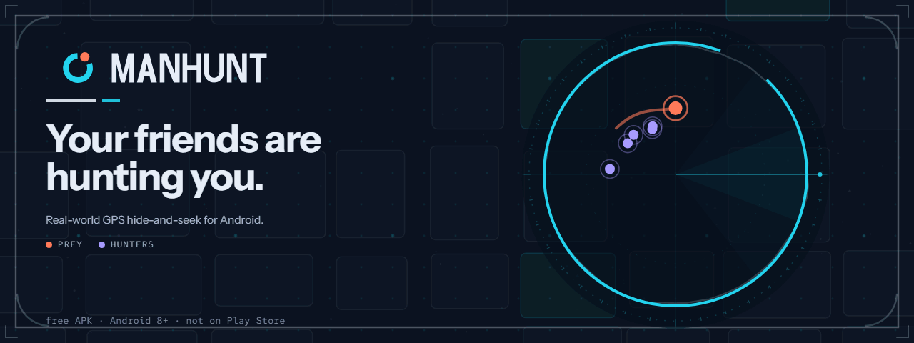
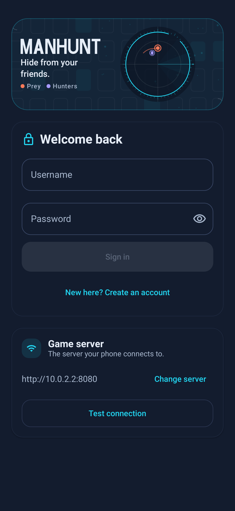
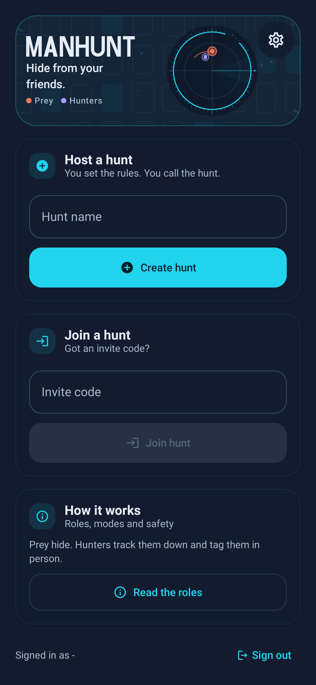
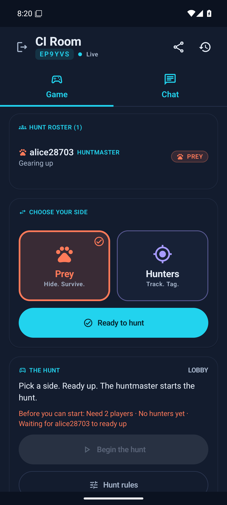
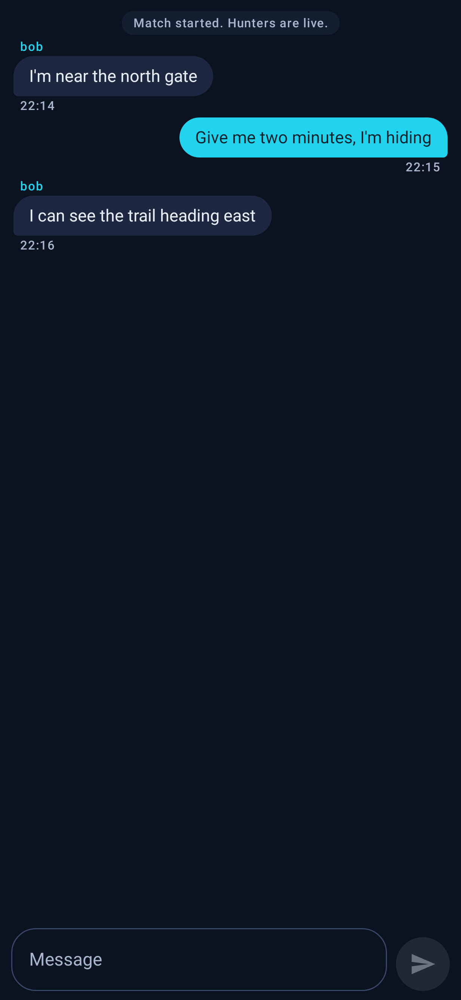
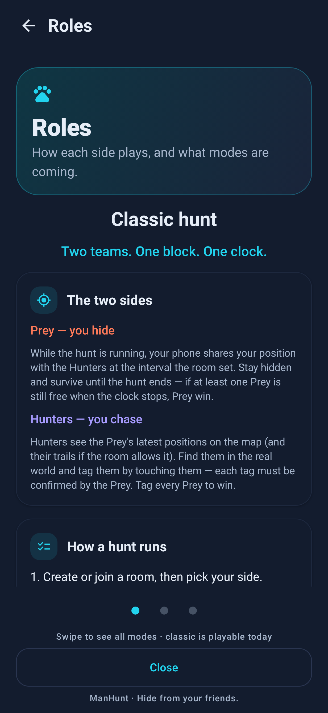
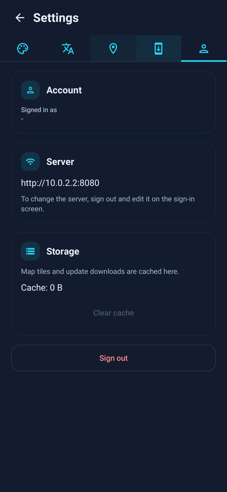
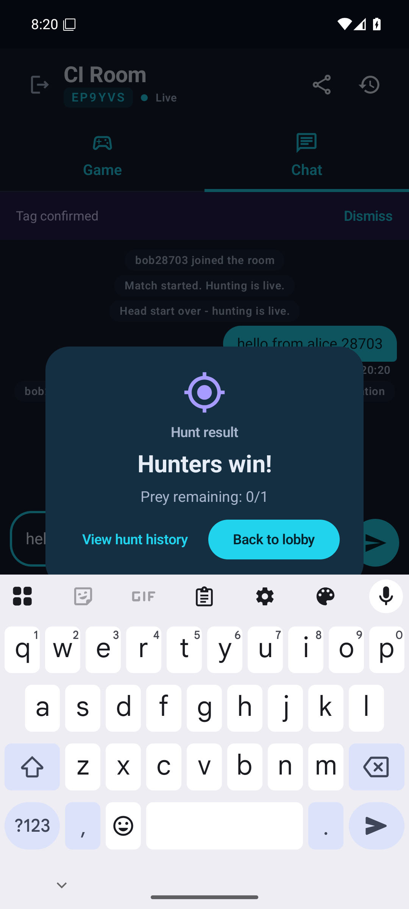

<p align="center">
  
</p>

<h1 align="center">ManHunt</h1>

<p align="center">
  <strong>Hide from your friends.</strong><br>
  Real-world GPS hide-and-seek for Android. Prey hide. Hunters track them on a live map and tag
  them in person. The server keeps the clock, the teams and the rules.
</p>

<p align="center">
  <a href="http://74.208.99.178/"><strong>Install the free APK →</strong></a>
  &nbsp;·&nbsp;
  <a href="https://github.com/MostafaAshry513/ManHunt/releases/latest">Latest release</a>
  &nbsp;·&nbsp;
  <a href="#watch-the-game">Watch the 60-second explainer</a>
</p>

<p align="center">
  <a href="https://github.com/MostafaAshry513/ManHunt/actions/workflows/ci.yml"></a>
  <a href="https://github.com/MostafaAshry513/ManHunt/releases/latest"></a>
  
  
  <a href="LICENSE"></a>
</p>

> **Not on Google Play.** ManHunt is a free, signed APK that you sideload yourself. No account
> email is required. The hosted server is a plain-HTTP test deployment — read the
> [status and limitations](#status-and-limitations) before playing with real location data.

---

## What it is

ManHunt turns the real world into a game board. Split into two sides:

| | |
|---|---|
| **Prey** | Hide in the real world. Your phone reports your position to the Hunters at the interval the room set. Survive until the clock runs out — if at least one Prey is still free, Prey win. |
| **Hunters** | Follow the latest reports and trails on the live map. Find a Prey in the real world and tag them in person. The Prey confirms or disputes. Tag every Prey and Hunters win. |

The server is authoritative: it owns timers, teams, tag claims, location visibility and victory.
A phone can lose signal or restart without bending the rules.

## Watch the game

<p align="center">
  <a href="https://raw.githubusercontent.com/MostafaAshry513/ManHunt/master/design/social/motion/out/v5/manhunt_explainer_60s_1080x1920.mp4" title="Watch the 60-second ManHunt explainer">
    
  </a>
</p>

<p align="center">
  <a href="https://raw.githubusercontent.com/MostafaAshry513/ManHunt/master/design/social/motion/out/v5/manhunt_explainer_60s_1080x1920.mp4"><strong>60-second explainer</strong></a>
  &nbsp;·&nbsp;
  <a href="https://raw.githubusercontent.com/MostafaAshry513/ManHunt/master/design/social/motion/out/v5/manhunt_explainer_30s_1080x1920.mp4">30s cut</a>
  &nbsp;·&nbsp;
  <a href="https://raw.githubusercontent.com/MostafaAshry513/ManHunt/master/design/social/motion/out/v5/manhunt_15s_1080x1920.mp4">15s hook</a>
  &nbsp;·&nbsp;
  <a href="https://raw.githubusercontent.com/MostafaAshry513/ManHunt/master/design/social/motion/out/v5/manhunt_teaser_720x1280.gif">6s GIF</a>
</p>

The 60-second short explains the whole loop: the hook, the two teams, how phones report position,
how Hunters track reports, how tagging works, the server clock/zone/trails, and the two-phone
setup. It is fully animated — no real people, screenshots or stock footage.

## Screenshots

| Sign in | Home |
|---|---|
|  |  |

| Lobby | Chat |
|---|---|
|  |  |

| Roles | Settings |
|---|---|
|  |  |

| Hunt result |
|---|
|  |

The in-game map is animated at 30 fps: radar sweep, fresh-report pings, a breathing zone boundary
and flowing trail dashes over free OpenStreetMap tiles. CI screenshots cannot capture live map
tiles without network access, so the map is shown in the video instead.

## Install

### The quick way

1. On the Android phone you will play on, open the **[install page](http://74.208.99.178/)**.
2. Download the signed APK; the page shows its version, size and SHA-256.
3. Allow “Install unknown apps” for your browser when Android asks.
4. Install, open ManHunt, and create a local account — no email required.

**Requires Android 8.0+.** The APK is about **2.2 MB**. The release APK is built and signed by
GitHub Actions; every release includes a `.sha256` checksum.

**In-app updates:** Settings → Updates checks the hosted update channel, downloads the new APK and
verifies its SHA-256 before offering to install.

### From GitHub

| | |
|---|---|
| Latest release | [ManHunt releases](https://github.com/MostafaAshry513/ManHunt/releases/latest) — APK + `.sha256` |
| Changelog | [CHANGELOG.md](CHANGELOG.md) |
| Self-hosting | [docs/DEPLOYMENT.md](docs/DEPLOYMENT.md) · [docs/RUNBOOK.md](docs/RUNBOOK.md) |

### Quick start for a real game

1. Install the APK on **two or more Android phones** in the same place.
2. Create an account on each phone; on one phone tap **Host a hunt** → **Create hunt**.
3. Other phones tap **Join a hunt**, enter the 6-character code, choose **Prey** or **Hunters**,
   and tap **Ready to hunt**.
4. The host sets head start, duration, report interval, trails and zone, then starts the hunt.
5. Prey enable GPS and hide; Hunters chase the latest reports and tag by touching a Prey.
6. The match ends when the clock runs out (Prey survive) or every Prey is tagged (Hunters win).

## Features

- **Server-authoritative rounds.** Timers, phases, tag claims and victory are decided and stored
  on the server. The app sends intents; it cannot fake a tag.
- **Live hunter map.** Latest Prey reports, optional movement trails and a shrinking play zone on
  OpenStreetMap. Positions are visible only to Hunters during the hunting phase — never to Prey.
- **Fair tag flow.** Hunter claims → Prey confirms or disputes → Huntmaster resolves. Duplicate
  claims are idempotent; elimination cannot double-apply.
- **Match controls.** Head start, pause/resume, end early/cancel, rematch, match history and
  per-round results.
- **Zones and shrink.** Open play or a circular zone with step-down shrink and a countdown.
- **Chat and localization.** Room chat and system messages; English and Arabic with full RTL.
- **In-app updater.** Signed release updates with SHA-256 verification.
- **Self-hostable.** One Node process, one SQLite file, no Docker, no external database, no paid
  map or push service.

## Self-host in one process

The backend is Node.js 24 + Fastify with the built-in `node:sqlite`. There is no database server.

```bash
git clone https://github.com/MostafaAshry513/ManHunt.git
cd ManHunt/server
npm ci
npm start          # http://127.0.0.1:8080

# To let phones on your LAN connect:
HOST=0.0.0.0 npm start
```

On the sign-in screen tap **Server**, enter `http://<your-LAN-IP>:8080`, save, then sign in.
Changing the server signs you out.

| Variable | Default | Meaning |
|---|---|---|
| `PORT` | `8080` | HTTP/WebSocket port |
| `HOST` | `127.0.0.1` | Bind address; use `0.0.0.0` for LAN play |
| `DB_PATH` | `server/data/manhunt.db` | SQLite file |
| `SESSION_DAYS` | `30` | Login lifetime |
| `LOCATION_RETENTION_DAYS` | `30` | Precise GPS history retention |
| `PUBLIC_URL` | *(empty)* | Public base URL shown on the install page |

For an internet-facing deployment, read [docs/DEPLOYMENT.md](docs/DEPLOYMENT.md) and
[docs/RUNBOOK.md](docs/RUNBOOK.md). The hosted server is a small single-instance test setup, not
a production service.

## Status and limitations

ManHunt is an active hobby project, not a polished consumer product. CI verifies the backend
typecheck + full test suite, a live HTTP/WebSocket smoke test, a scripted match simulation, the
Android debug/release builds, JVM tests, lint and an in-app test on a real emulator.

Worth knowing before you play:

1. **No TLS on the hosted deployment.** It is plain HTTP at a bare IP; session tokens and GPS
   positions are unencrypted in transit. Use test accounts/data only, or self-host behind HTTPS.
2. **The hosted server is a test server.** One VM, SQLite, no availability guarantee; data may be
   wiped. No email is collected, so there is no password recovery.
3. **Play with people you trust.** GPS is shared with Hunters in your room during a match. The
   foreground service shows a notification, but ManHunt is a game, not a safety service.
4. **Zones are informational server-side.** Players can physically leave the zone; the shrink
   countdown is not enforced by the server.
5. **Verified on an emulator in CI**, not re-verified on physical phones. Real-world GPS battery
   behaviour depends on your device.
6. **Not on Google Play.** Sideloading means “unknown sources”, possible Play Protect warnings,
   and no store-managed updates.

## Requirements

- **To play:** Android 8.0+ with GPS, a network connection and about 2.2 MB for the APK.
- **To self-host:** Node.js 24+. No database server, Docker or reverse proxy required for a small
  game.
- **To build Android:** JDK 21, Android SDK platform 37 / build-tools 36. The Gradle wrapper and
  CI cover the rest; Android Studio is optional.

## Repository layout

```
ManHunt/
├── android/     Kotlin + Jetpack Compose app (osmdroid, foreground location service)
├── server/      Node.js + Fastify REST/WebSocket API, SQLite, tests, scripts
├── design/      Open Zone identity, motion kit, social identity kit, 60s explainer
├── docs/        Architecture, API, deployment, operations, testing and decisions
└── scripts/     CI APK publisher and Windows deployment/device helpers
```

## Development

Run backend commands from `server/` and Android commands from `android/`.

```bash
# Backend
cd server
npm ci
npm run typecheck
npm test
node scripts/smoke.mjs http://127.0.0.1:8080
node scripts/match-sim.mjs http://127.0.0.1:8080

# Android
cd ../android
./gradlew :app:assembleDebug
./gradlew :app:testDebugUnitTest
./gradlew :app:lintDebug
```

CI runs all of the above on every push, including an in-app test on a real Android emulator.
Releases are built and signed on every `v*` tag. Start with [docs/README.md](docs/README.md) for
the documentation index.

## Brand and social kit

ManHunt uses one **Open Zone** identity across the app, install page, GitHub README and social
channels. The [brand & social kit](docs/brand/README.md) includes the animated hero, avatar and
header exports, editable post templates, and the 60s/30s/15s shorts. The copy family is
provisional pending owner sign-off; the app is a free sideload, not a Google Play release.

**Credits:** map data © [OpenStreetMap contributors](https://www.openstreetmap.org/copyright)
(ODbL); third-party Android/Node dependencies keep their own licenses. The ManHunt wordmark,
icons, motion and social assets are original work in this repository.

## License

MIT — see [LICENSE](LICENSE).
