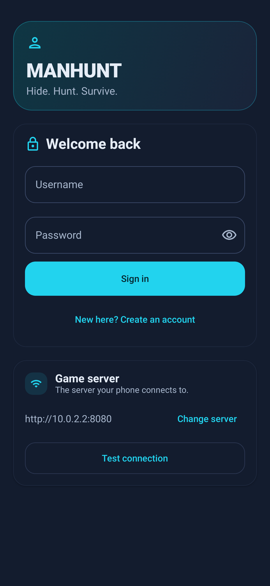
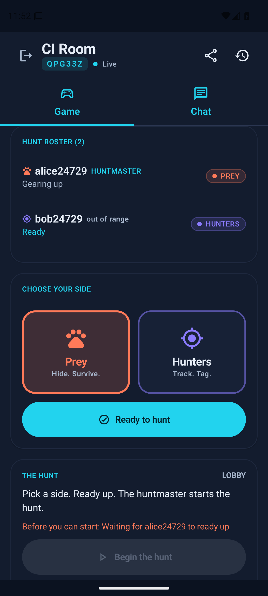
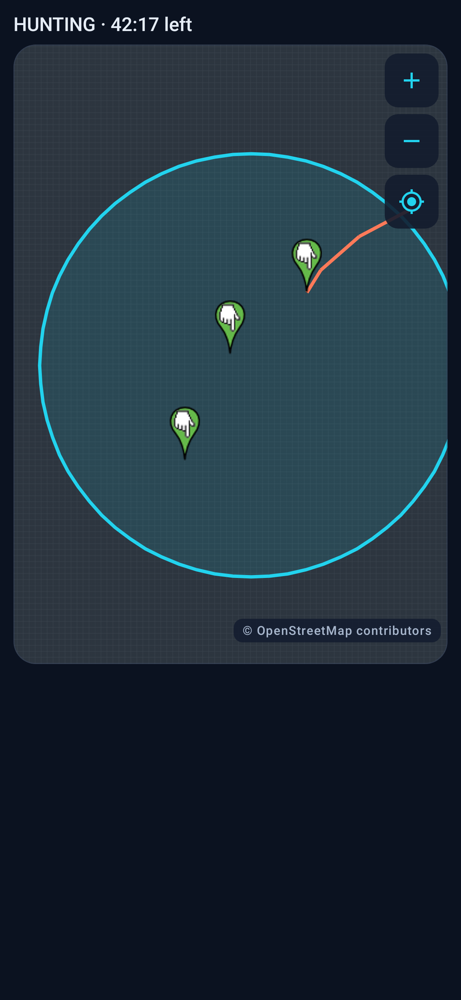
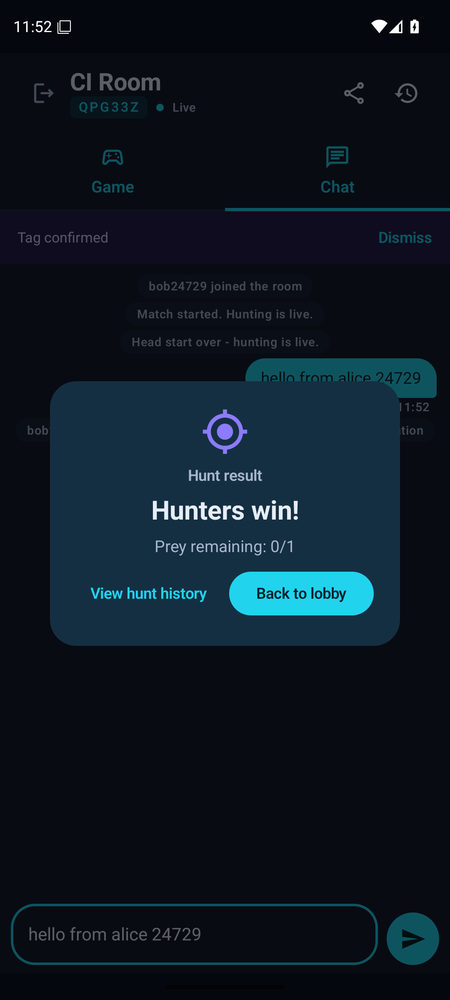

# ManHunt

**Real-world hide-and-seek for Android.** Prey hide in the real world while their phones report
their GPS positions; Hunters follow those positions on a live map and tag prey by physically
touching them. The server is authoritative — it owns timers, teams, tags, location visibility and
chat — so a phone can lose signal or restart without breaking the game.

[](https://github.com/MostafaAshry513/ManHunt/actions/workflows/ci.yml)
[](https://github.com/MostafaAshry513/ManHunt/releases/latest)
[](LICENSE)

## Screenshots

| Sign in | Lobby | Chat (dark) |
|---|---|---|
|  |  |  |

| Chat (Arabic, RTL) | Hunting map | Hunt result |
|---|---|---|
|  |  |  |

The lobby and result screenshots are captured by the real-emulator CI job; the rest come from the
Robolectric screenshot tests. Map tiles come from OpenStreetMap at runtime and need network access;
a render captured without network shows a blank tile layer (the Robolectric hunting-map shot draws
the zone, trail and prey markers on top of a deliberately blank tile layer).

## Download and install

**Fastest: the [install page](http://74.208.99.178/) — it always serves the latest signed APK
with its SHA-256.** You can also take the release straight from GitHub:

| Source | Link |
|---|---|
| Install page (hosted test server) | <http://74.208.99.178/> |
| GitHub release | [v0.9.0 release notes](https://github.com/MostafaAshry513/ManHunt/releases/latest) |
| Direct APK | [manhunt-v0.9.0.apk](https://github.com/MostafaAshry513/ManHunt/releases/download/v0.9.0/manhunt-v0.9.0.apk) |
| Checksum | [manhunt-v0.9.0.apk.sha256](https://github.com/MostafaAshry513/ManHunt/releases/download/v0.9.0/manhunt-v0.9.0.apk.sha256) |

- **Requires Android 8.0 (API 26) or newer**; about 14 MB. The release APK is a signed
  `assembleRelease` build produced and signed by GitHub Actions.
- ManHunt is **not on Google Play**. Install it as a sideloaded APK:
  1. Download the APK on the phone.
  2. Open it and confirm; Android will ask you to allow installs from unknown sources for the
     app you downloaded from (Settings → Apps → Special app access → Install unknown apps).
  3. Install, then open ManHunt. Play Protect may warn about an app installed from a browser —
     that is normal for sideloaded apps; choose "Install anyway" only if you trust this repo.
  4. Create a local account and play — no email address is required.
- **In-app updates:** Settings → Updates checks the server's update channel, shows the new
  version, downloads the APK and verifies its SHA-256 before offering to install. Release
  builds are pointed at the hosted server out of the box.

> **Test deployment, plain HTTP.** The hosted server and install page are a public test
> deployment served over plain HTTP (no TLS). Session tokens and GPS positions are not
> encrypted in transit. Use it for test games only — see [Status and limitations](#status-and-limitations).

## Quick start

### Play on the hosted server

1. Install the APK on two or more Android phones (see above). They are already pointed at
   `http://74.208.99.178`.
2. Open the app, create an account on each phone (username 3–24 letters/digits/underscore,
   password 8+ characters), then on one phone tap **Host a hunt** → **Create hunt**.
3. On the other phones tap **Join a hunt**, enter the 6-character room code, choose a side
   (**Prey** or **Hunters**) and tap **Ready to hunt**.
4. The host opens **Hunt rules** (head start, duration, report interval, trails, zone) and taps
   **Begin the hunt**. Prey enable GPS and hide; Hunters track them. Tag by tapping the prey
   when you are physically close — the prey confirms or disputes.
5. The match ends on the timer (Prey win if anyone survives) or when every prey has been tagged
   (Hunters win). History is in the room, and the hunt can be started again as a rematch.

### Self-host the server

The backend is one Node.js process using the built-in `node:sqlite`; there is no database
server, Docker or external dependency.

```bash
git clone https://github.com/MostafaAshry513/ManHunt.git
cd ManHunt/server
npm ci
npm start          # listens on http://127.0.0.1:8080
```

To accept phones on your network, bind all interfaces and point the app at it:

```bash
# macOS / Linux / Git Bash
HOST=0.0.0.0 npm start

# Windows PowerShell
$env:HOST = '0.0.0.0'; npm start
```

On the sign-in screen tap the **Server** row, enter `http://<your-machine-LAN-IP>:8080`, tap
**Save server**, then sign in. The debug APK defaults to `http://10.0.2.2:8080` (the host from an
emulator). Changing the server signs you out.

| Variable | Default | Meaning |
|---|---|---|
| `PORT` | `8080` | HTTP/WebSocket port |
| `HOST` | `127.0.0.1` | Bind address; `0.0.0.0` for phones on the network |
| `DB_PATH` | `server/data/manhunt.db` | SQLite file |
| `SESSION_DAYS` | `30` | Login token lifetime |
| `LOCATION_RETENTION_DAYS` | `30` | Precise GPS history retention |
| `PUBLIC_URL` | *(empty)* | Public base URL shown on the install page |

For an internet-facing deployment, read [docs/DEPLOYMENT.md](docs/DEPLOYMENT.md) and
[docs/RUNBOOK.md](docs/RUNBOOK.md) first — the hosted server is a small single-instance setup,
not a production service.

## Features

- **Server-authoritative gameplay.** Timers, phases, teams, tag outcomes and victory are decided
  and persisted on the server; the app only sends intents. Clients cannot fake a tag or a phase.
- **Live hunter map.** Prey positions, an optional movement trail and the hunt zone on an
  OpenStreetMap map (osmdroid). Positions are visible only to Hunters during the hunting phase —
  never to Prey, and Admins get no extra location power.
- **Durable tag claims (v0.9.0).** A tag request is stored on the server, so the Prey still sees
  it after a reconnect. If it is not confirmed, disputed or resolved within 90 seconds it becomes
  a dispute the Huntmaster must settle.
- **Tag flow with fair resolution.** Hunter claims → Prey confirms or disputes → Huntmaster
  resolves a dispute. Duplicate claims are rejected or idempotent; elimination cannot double-apply.
- **Match controls.** Head start, pause/resume (the match clock is frozen and shifted, so no time
  is lost), end early/cancel, rematch, and match history in the room.
- **Zones and shrink.** Open play or a circular zone, optionally shrinking step by step, with a
  countdown shown to players.
- **Chat and localization.** Room chat plus system messages; English and Arabic with full RTL,
  dark theme by default and adjustable text size.
- **In-app updater.** Checks the server's update manifest, downloads the APK and verifies its
  SHA-256 before installing.
- **Self-hostable.** One Node process, one SQLite file, no Docker, no external database, no paid
  map or push services.

## Status and limitations

The project is an **active hobby project at v0.9.0**, not a polished consumer product. What is
verified in CI on every push:

- **Backend:** TypeScript typecheck, the full `node --test` suite (auth, rooms, match lifecycle,
  tags, locations, history, security), plus a live HTTP + WebSocket smoke test and a three-player
  match simulation against a running server.
- **Android:** debug build, Robolectric/JVM unit tests, Android lint, and an in-app test on a real
  Android emulator.
- **Releases:** every tag is built and signed by GitHub Actions; each release ships the APK and a
  `.sha256` checksum, and the hosted install page/update channel serves the same signed APK.

Still true and worth knowing:

1. **No TLS on the hosted deployment.** It is plain HTTP at a bare IP: there is no domain and no
   certificate. Session tokens and location data are unencrypted in transit. Do not use the hosted
   server for real sensitive location data; self-host behind HTTPS if you need that.
2. **The hosted server is a test server.** It is a single VM with SQLite and no availability
   guarantee; its data may be wiped. There is no account recovery — no email is collected, so a
   forgotten password means creating a new account.
3. **Location privacy needs trusted players.** GPS is shared only with the Hunters in your room
   during a match, and the foreground tracking service shows a notification, but the game is
   still about broadcasting your location to other people. Play with people you trust. ManHunt is
   a game, **not a safety service**.
4. **Zone boundaries are not enforced server-side.** A player can physically leave the zone; the
   shrink countdown is informational only, and there is no separate "zone shrinking soon" alert.
5. **Match history rosters use current room membership**, not a per-match snapshot.
6. **Not on Google Play.** Sideloading means "unknown sources" and possible Play Protect warnings,
   and no store-managed updates.
7. **The current build is verified on an Android emulator**, not re-verified on physical phones
   (the last on-device verification was an earlier version). Real GPS battery behaviour in the
   field is therefore not guaranteed.

Planned next: TLS/domain in front of the public deployment, Play Store distribution, server-side
zone enforcement, and per-match history rosters.

## Requirements

- **To play:** an Android 8.0+ phone with GPS and a network connection (about 14 MB free).
- **To self-host:** Node.js 24 or newer. That is the whole runtime — no database server, no
  Docker, no reverse proxy required for a small game.
- **To build the Android app:** JDK 21 and Android SDK platform 37 / build-tools 36. Android
  Studio is optional; the Gradle wrapper and CI do the work. See
  [docs/TESTING.md](docs/TESTING.md).

## Repository layout

```
ManHunt/
|-- android/        Kotlin + Jetpack Compose app (osmdroid map, foreground location service)
|-- server/         Node.js + Fastify REST/WebSocket API, SQLite (node:sqlite), tests, scripts
|-- docs/           Architecture, API reference, operations and quality docs (start at docs/README.md)
|-- scripts/        CI APK publisher and Windows deployment/device helpers
`-- .github/        GitHub Actions: CI (server, Android, emulator) and tag-driven signed releases
```

## Development and testing

Run backend commands from `server/` and Android commands from `android/`. The smoke and
simulation scripts need a server already listening on the URL you pass them.

```bash
# Backend
cd server
npm ci
npm run typecheck
npm test                                          # node --test suite
node scripts/smoke.mjs http://127.0.0.1:8080      # live HTTP + WebSocket checks
node scripts/match-sim.mjs http://127.0.0.1:8080  # scripted 3-player match

# Android (Gradle wrapper; on Windows you can also use .\build.ps1, .\test.ps1, .\install.ps1)
cd ../android
./gradlew :app:assembleDebug
./gradlew :app:testDebugUnitTest
./gradlew :app:lintDebug
```

CI (`.github/workflows/ci.yml`) runs all of the above against every push, including the emulator
in-app test; the release workflow (`.github/workflows/release.yml`) builds and signs the APK for
every `v*` tag. Current commands and coverage are documented in [docs/TESTING.md](docs/TESTING.md).

## Documentation

Start at the [documentation index](docs/README.md) for a guide by audience (`Start here`,
`Operations`, `Quality`, and the historical archive). Highlights:

- [Architecture](docs/ARCHITECTURE.md) — components, match state machine, data model, API/WS
  contracts, security boundaries
- [API reference](docs/API.md) — every REST endpoint and WebSocket event, settings, phases
- [Decisions](docs/DECISIONS.md) — architecture decision records
- [Deployment](docs/DEPLOYMENT.md) | [Runbook](docs/RUNBOOK.md) — self-hosting and operations
- [Security](docs/SECURITY.md) | [Testing](docs/TESTING.md) | [Performance](docs/PERF.md)
- [Customization](docs/CUSTOMIZATION.md) — themes, languages, server address, forking
- [Contributing](CONTRIBUTING.md)

## License

MIT — see [LICENSE](LICENSE). Map data © [OpenStreetMap contributors](https://www.openstreetmap.org/copyright)
(ODbL); third-party Android/Node dependencies keep their own licenses.
