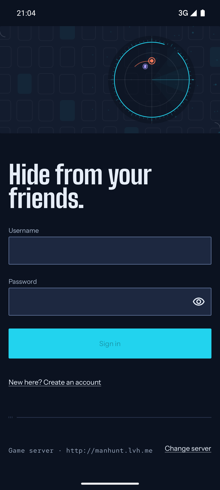
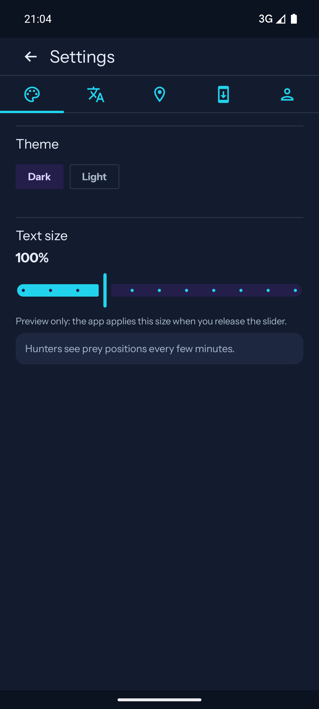

# ManHunt MATCHDAY — final matchday audit

Independent adversarial audit of the v0.16.0 "MATCHDAY BOARD" sprint. Read-only: no code/assets changed; this document plus `design/audits/evidence/` are the only additions.
Date: 2026-11-02 · Repo: `C:\dev\ManHunt` @ `1a2c441` (master, working tree had only in-flight `design/social/matchday/`) · Live: http://74.208.99.178/

**Verdict: NEEDS ANOTHER PASS.** The design direction is genuinely premium and internally consistent, the app captures are real (no mockups), the live site is current, the README is pushed and its assets resolve, and the APK hash claim verifies byte-for-byte. But the "final" evidence set ships a handful of visible defects and one factually wrong product claim: a dev server URL in the flagship auth frame, a visually broken slider in the Settings frame, a clipped expanded sheet, cross-surface clock/code/size drift (41:14 vs 41:12, WNWHA3 vs VMJYBU, 2.2 MB vs 2.48 MB), and "Prey never see the map" — which the app (and the sprint's own prey-view capture S08) contradicts. The new social pack is still landing (only 7 test stills exist) and the committed site QA captures are a release behind the live site. None of these are design-direction problems; they are a focused cleanup + a small reshoot before the sprint can be called complete.

---

## How this was audited

Inspected with image tools + source/network cross-checks:

| Surface | What I actually inspected |
|---|---|
| Premium captures | All 14 full frames (`docs/screenshots/premium/s01..s15`), `contact-sheet.png`, `MANIFEST.json` (all 14 shot + 7 crop SHA-256s re-computed), `harvest/` crops |
| Premium spec | `design/redesign/screenshot-shotlist.md` (§0 capture rules, §2 seeded scenario, S01–S19, §5 acceptance), `design/redesign/screens/*`, MANIFEST pending/dataGap fields |
| Live game site | Live `http://74.208.99.178/` HTML + headers, `/api/app/latest`, `/app.apk` (downloaded: 2,476,954 B, SHA-256 re-computed), 8 live `/media/*.jpg`; source `design/site-redesign/`, committed QA shots + `report.json` |
| GitHub | `README.md` vs `raw.githubusercontent…/master/README.md` (line-diff: 0), HEAD checks on every embedded image/video raw URL, GitHub repo page meta/og, latest release + assets |
| Brand assets | `docs/brand/README.md`, matchday hero GIF/PNG, map band, tag plates, explainer cover, lockup icons; repo description/og:description |
| Social reel | `design/social/matchday/` (src/tools/out) — in flight during this audit; 7 generated stills reviewed |
| App/spec cross-check | `ScorePage.kt`, `RoomScreen.kt` (TacticalHuntPage), `MatchMap.kt`, `Theme.kt`, version/manifest; claims re-checked against captures |

Evidence copied under `design/audits/evidence/` (live media + HTML snapshot + `live-site-checks.txt`). Not auditable from this host: the social film's final rendered outputs (not generated yet), GitHub repo *settings* (social preview upload, topics), and a fresh screenshot of the live site at v0.16.0 (committed QA shots are v0.15.1 — see B7).

---

## Surface scores (human reviewer, 5 = premium & coherent, 1 = broken)

| # | Surface | Score | One-line judgement |
|---|---|---|---|
| 1 | Premium app captures (`docs/screenshots/premium/`) | **3 / 5** | Direction and data are premium; 4 frames carry visible defects that poison the "premium" claim. |
| 2 | Live game site (v0.16.0) | **4 / 5** | Credible, current, honest, properly served; light polish only. |
| 3 | GitHub README + repo page | **3 / 5** | Pushed, same product voice, assets resolve — but stale alt numbers/size and one false claim. |
| 4 | Brand assets / `docs/brand` | **3 / 5** | Strong v2 assets, but legacy v1 kit mixed in without marking; two "social preview" entries. |
| 5 | Social reel / social pack (`design/social/matchday/`) | **2 / 5** | Not landed: sources + test stills only. Preview direction is good; no final deliverable to certify. |
| 6 | App redesign spec vs real captures | **3 / 5** | Core direction implemented; S12/S13/S14 captures miss their own acceptance criteria. |
| 7 | Cross-surface coherence (app ↔ site ↔ GitHub ↔ social) | **3 / 5** | Same brand story everywhere, but numbers/details drift between surfaces. |
| 8 | Honesty & trust | **3 / 5** | Unusually honest limitations (sideload, plain HTTP, test server, SHA) undercut by one false product claim + stale evidence. |

**Weighted overall: 3 / 5 — brilliant at 10 feet, leaks at 10 inches. Does not yet meet "premium and coherent" as a final, signable set.**

---

## Blockers (must fix before sprint-complete)

**B1 — Dev server host in the flagship auth frame.**
`docs/screenshots/premium/s01-auth.png` shows `Game server · http://manhunt.lvh.me` (and `Change server`). `lvh.me` is a localhost alias, i.e. exactly the class of dev string the set's own rules ban: shotlist §0 rule 5 (`design/redesign/screenshot-shotlist.md:27-29`) bans `10.0.2.2`, `localhost`, test codes; S01 acceptance (`:109-110`) says "no dev server address". Re-capture with the public row (`http://74.208.99.178`) or the collapsed server row. Same frame also shows a **3G** signal while §0 rule 3 (`:21-24`) requires "Wi-Fi only, full" — the MANIFEST instead documents "clean cellular signal", so the rig itself diverged from the spec.

**B2 — Broken-looking slider in the Settings premium frame.**
`docs/screenshots/premium/s14-settings.png`: the "Text size 100 %" control renders as two overlapping affordances — a filled cyan bar with knuckle dots ending in a tall detached vertical cyan thumb, then a separate dot rail. It reads as a drawing bug, not a slider, and it is the only interactive control on the screen. It also directly contradicts S14 acceptance (`:202-204`): "no icon tabs, no chips" — the capture shows a five-icon unlabeled tab row and chip-styled Dark/Light selectors. Re-shoot after fixing the custom slider drawable; reconcile spec with the actual (better) design.

**B3 — Clipped content in the expanded hunt sheet.**
`docs/screenshots/premium/s10-hunt-sheet.png`: the roster inside the expanded sheet is cut mid-row by the gesture bar (a violet team pill is sliced at the bottom edge), and the sheet/zoom-control boundary looks accidental. Violates §0 rule 9 ("No tearing/clipping… no partially visible dialogs", `:37-38`). Re-capture with the sheet scrolled to a clean stop or add bottom inset + internal padding.

**B4 — Cross-surface number/code/size drift.**
The same facts disagree between owned surfaces:
| Fact | Premium captures / site / app | GitHub README | Brand hero asset |
|---|---|---|---|
| Clock at S07 | **41:12** (`s07-hunt.png`, site alt "server clock at 41:12", social still 41:12, shotlist `:84`) | alt text says **41:14** twice (`README.md:3,57`) | `docs/brand/matchday-hero-1280x560.png/.gif` board reads **41:14** |
| Lobby code | **VMJYBU** (S05/S06 + README image) | alt text says **WNWHA3** (`README.md:57`) | — |
| APK size | Live site/API **2.4 MB** (2,476,954 B) | "about **2.2 MB**" (`README.md:99`) | — |
Fix: one canonical value per fact, regenerate hero asset + README alts; make the hero board use the same 41:12 as the capture.

**B5 — False product claim: "Prey never see the map."**
Both `README.md:21` and the live site's field section state "Prey never see the map." That is not what the app does: the tactical hunt page renders `MatchMap` for every role and only hides *prey markers* (`RoomScreen.kt:2004-2016`, `showPrey = me?.team == Teams.HUNTERS`), so Prey see the field, the zone and their own position. The sprint's own **S08 is a Prey-view capture with the map visible behind the claim sheet** (`s08-hunt-claim.png`), which visually contradicts the marketing line. Fix the copy on both surfaces — e.g. "Hunters see the latest reports; Prey only see the field — never other players' positions." (The site FAQ "Prey never see locations" is accurate; keep that one.)

**B6 — Social reel/pack not landed.**
`design/social/matchday/` is incomplete at audit time: sources (`src/index.html`, `styles.css`, `animate.js`, `tools/capture.mjs`), premium-screen assets, and only 7 generated test stills in `out/stills/` (`test-hook`, `test-home`, `test-lobby`, `test-hunt`, `test-claim`, `test-result`, `test-end`). No final 15s/30s/60s outputs, no `out/qa`, no release copy. The two stills reviewed are on-brand and clean (`test-hook.png` hook frame; `test-hunt.png` map frame with "© OpenStreetMap contributors"), so the direction is right — but the deliverable the Lead explicitly asked to review "when it lands" has not landed and cannot be certified final.

**B7 — Site QA evidence is a release behind the live site.**
Committed captures in `design/site-redesign/shots/final/` show **v0.15.1 / 2.1 MB** and "10 accounts started / +4 new this week" (desktop/mobile viewports, `report.json` generatedAt 05:05Z); the live site now serves **v0.16.0 / 2.4 MB** and "9 accounts started / +9 new this week" (verified live, `design/audits/evidence/live-site-checks.txt`, captured 05:29Z). The live HTML itself is correct and secure (`Content-Type: text/html; charset=utf-8`, CSP, `X-Frame-Options: DENY`, `Referrer-Policy: no-referrer`); the *evidence set* is not. Refresh `shots/final` against v0.16.0 before sign-off. (Tablet QA also flags a 3 px text overflow of "Latest report"; mobile flags 3 off-canvas decorative SVG circles — benign since `horizontalOverflow:false`, but re-verify in the refresh.)

**B8 — S13 result data and its MANIFEST note contradict each other.**
`s13-result-prey.png` displays "Prey win." with **"Prey remaining: 2 / 2"**, while `MANIFEST.json` describes the scenario as "Prey win variant, one prey survived" and records `dataGap: S13 survivor count unavailable (server resets eliminations at finish)`. Both cannot be true. The v0.16.0 release notes say the result screen now uses the authoritative finished snapshot (`ScorePage.kt` shows honest degradation: score line only when counts known), so either 2/2 is the honest final count (both Prey alive at full time) and the MANIFEST wording/dataGap must be corrected, or the count is wrong and the app needs the fix. For a sprint whose pitch is "the server keeps it honest", the evidence manifest must be as honest as the app.

---

## Polish (should fix next pass, not sprint-blocking)

- **P1 — No marker legend.** S07/site hero/social map show coral (fresh) + white (stale) markers and a dashed trail with no in-UI key; only the website alt text explains it. Add a tiny legend chip or marker names; the flagship map should be readable without a caption.
- **P2 — Button/sheet shape drift inside the same design system.** S07/S10 use stadium pills for "Tag prey", "Hide trails", "View hunt history" while the rest of MATCHDAY (Create hunt, Begin the hunt, Back to lobby) uses rectangular Board buttons; S07's sheet has rounded top corners while S08/S09 sheets are square. Pick one geometry and apply to the dock/sheets.
- **P3 — S06 team-selector misalignment.** With 2 Prey vs 3 Hunters, the "Prey" and "Hunters" plates sit at different heights and leave a hole under the Prey column; in a hero-quality frame it reads as a layout slip. Equalise columns or move side selection into the pinned dock.
- **P4 — Two clocks disagree inside one frame.** Masthead live clock shows 21:05 (S03) and 21:10 (S04, S15) while the frozen status bar says 21:04. Either set the status bar from the same clock or hide the masthead clock during capture; the shotlist's consistency bar (`:246-248`) expects plausible time progression.
- **P5 — S11 chat composition.** Field-log messages are top-anchored leaving ~28 % empty between 20:52 and the composer; for the premium set either fill the seeded log or deliberately frame it. Own messages are not visually distinguished from others (Omar's line looks identical in weight).
- **P6 — S07 clock unlabelled.** "41:12" under a LIVE chip can read as elapsed time; one small "remaining"/"left" label (or the Board's existing "HUNTING" kicker retained) removes ambiguity.
- **P7 — README weight.** GitHub README downloads ~3.4 MB of media (813 KB hero GIF + 493 KB map band + 8 full-res 1080×2400 PNGs up to 1.19 MB). Consider 460 px-wide thumbs (link to full) or a lighter hero GIF; mobile GitHub first paint is slow.
- **P8 — `docs/brand/README.md` mixes v1 and v2.** It lists legacy `readme-hero.gif`, an old `github-social-1280x640.png` *and* the new `github-social-matchday-1280x640.png`, plus pre-MATCHDAY contact sheets, with no "legacy/current" marking ("Copy is provisional pending owner approval"). The live site footer links to this page, so external designers see two generations mixed together.
- **P9 — GitHub custom social preview not configured.** The repo's `og:image` is GitHub's generated `opengraph.githubassets.com` card, not the designed `docs/brand/github-social-matchday-1280x640.png`; shared links don't show the MATCHDAY face. (Repo-settings upload — cannot be fixed by commit.)
- **P10 — Site mobile details.** Hero meta wraps with a leading separator ("…Android 8.0+ / | Not on Play Store"); mobile nav has only the Download CTA (no section anchors); "9 accounts started" is honest but weak social proof for a launch page — consider "test deployment" framing or a stronger, still-honest stat.
- **P11 — Missing P2 frames per MANIFEST.** `s02-safety`, `s16-lobby-rtl`, `s17-empty-chat`, `s18-auth-loading`, `s19-auth-error` are pending. That's allowed by the shotlist, but marketing claims "full RTL" while the set evidences only RTL Home (S04) — no RTL lobby/hunt/settings, and no first-run safety screen in the premium set. Capture S02 + S16 if the launch copy keeps the RTL/trust claims.
- **P12 — Result screen thinner than its own spec.** `ScorePage.kt` supports final team sheets and honest summary, but S12/S13 show only winner + score + decorative plate + two buttons. Shotlist S12 asks for "honest summary… trail plate… final team sheets". Either capture a snapshot that includes the final roster or scope the spec down.

---

## What is genuinely strong (credit where due)

- **The premium set is real.** Emulator capture, one device profile (1080×2400 @420 dpi), deterministic demo status bar, believable "Riverside Run" data, real OSM tiles with attribution visible in the map frames. All 14 shot SHA-256s and all 7 crop SHA-256s in `MANIFEST.json` re-verify byte-exactly; pending screens are honestly marked pending instead of substituted with old UI. That is more capture discipline than most apps ship.
- **Hero frames look premium.** S03 (condensed "Hide from your friends." + Open Zone plate + CodePlate join), S05 (matchday team sheet with invite-code plate and READY count), S07 (Board clock + Zone/Prey data + teal field + Tag dock), S12 (full-time scoreboard) — the type system, flat boards, mono metadata and cyan/coral/violet role language hang together and read as "match equipment, not a dashboard", exactly as the release notes claim.
- **Live site is current and well-served.** v0.16.0 data, UTF-8, CSP / X-Frame-Options / Referrer-Policy, real premium captures as `/media/*.jpg`, OSM attribution on every map, honest install/limitations/FAQ copy, no dev URLs, no old slogan, no mojibake. `/api/app/latest` and `/app.apk` agree with the page: versionCode 43, v0.16.0, 2,476,954 B, SHA-256 `df6765…44ea4` **verified**.
- **GitHub README is pushed and coherent.** Local README is line-identical to `raw.githubusercontent…/master/README.md`; every embedded image/video raw URL returns 200 with the expected sizes; repo description/og:title use the same "Hide from your friends." line; release `v0.16.0` ships APK + SHA-256 asset. No old slogan or placeholder text in README.
- **RTL and light theme exist and look intentional** (S04 home RTL: masthead, clock, host/join blocks, code plates all mirror; S15 light: ink masthead, chalk plates, dark board band stays as anchor). Not just a checkbox.
- **The in-flight social stills are promising**: hook frame ("YOUR FRIENDS ARE HUNTING YOU.") and map frame ("THE MAP HAS YOUR LAST REPORT." + © OpenStreetMap contributors) match the app brand precisely — the only problem is they are test stills, not a finished reel.

---

## Top 5 issues (ranked, for the Lead)

1. **B1 — dev host `manhunt.lvh.me` + 3G signal in the flagship S01 auth frame** (spec-banned).
2. **B2 — visibly broken text-size slider in S14** (and S14 contradicts its own "no icon tabs, no chips" acceptance).
3. **B4 — cross-surface drift: 41:14 (README alts + brand hero asset) vs 41:12 (site/captures/social); WNWHA3 vs VMJYBU; 2.2 MB vs 2.4 MB.**
4. **B5 — false claim "Prey never see the map" on README + live site**, contradicted by app code and the sprint's own S08 prey-view capture.
5. **B6+B7 — social MATCHDAY pack not landed (test stills only) and committed site QA captures are v0.15.1 while the live site is v0.16.0.** (Honourable mentions: B3 clipped S10 sheet; B8 S13/MANIFEST data contradiction.)

---

## Verdict

**NEEDS ANOTHER PASS — narrow and mechanical, not a redesign.** The MATCHDAY direction itself clears the bar: app screens, site, README and social previews now look like one premium product with a distinct voice (condensed boards, mono data, cyan field, honest sideload story), and the hard, unsexy parts — real device capture, deterministic data, checksummed manifest, served site with correct headers, verified APK hash, pushed README — are done properly. What keeps this from being a final matchday set is execution hygiene at the edges: one banned dev URL, one broken control, one clipped frame, a handful of numbers that disagree between surfaces, a product claim that is simply false, a social pack still rendering, and site evidence one release old. Fix B1–B8 (plus B4's asset regeneration), re-shoot S01/S14/S10 (and ideally S06 alignment + S12 full result), refresh the site evidence set at v0.16.0, land and QA the social reel, then this audit flips to **meets the bar**. I would not hand the current captures/site to a press or partner reviewer yet; I would happily hand them over after that pass.
